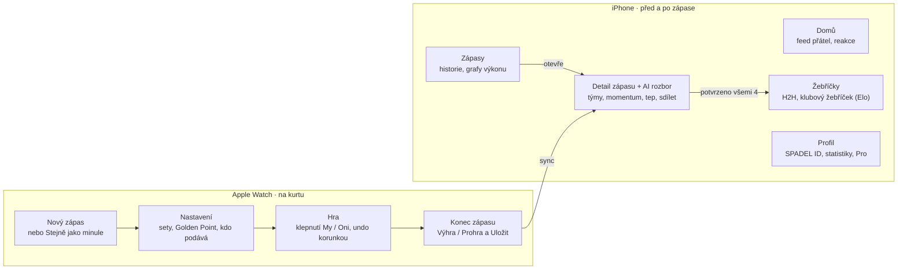

# SPADEL – uživatelské cesty

Jak hráči SPADEL používají: persony, jejich chování kolem zápasu, hlavní cesty na hodinkách a iPhonu a mapa obrazovek. Odsouhlaseno se Zdeňkem 22. 10. 2026. Pracovní verze s komentáři je v [Claude Doc](https://claude.ai/artifact/N4aS45ZkwHywXdk6HdXmi4).

## Princip: hodinky hrají, telefon vypráví

Hodinky jsou nástroj na kurtu: zápas se spustí do 3 klepnutí a bod se zapíše jedním klepnutím, bez čtení a bez přemýšlení. Telefon je místo pro všechno ostatní: příprava zápasu, rozbor, historie a rivalita s kamarády.

- **Na kurtu nic nepřekáží hře.** Na hodinkách žádné formuláře, psaní ani rozhodování, které počká na později.
- **Chyba se dá vrátit.** Undo je vždy po ruce, protože na kurtu se klepne vedle.
- **Funguje bez signálu.** Zápas se nahrává offline a synchronizuje se sám, až je telefon v dosahu.
- **Odměna hned po zápase.** Výsledek a AI rozbor čekají na telefonu dřív, než si hráč sundá čelenku.
- **Každý zápas má i soupeře.** Potvrzený zápas automaticky posune H2H a žebříček, takže má smysl nahrát každý.

## Persony

Tři persony vycházejí ze zákaznických segmentů v [Lean Canvasu](lean-canvas.md), čtvrtá je spoluhráč bez aplikace, protože padel je čtyřhra a na kurtu bude často jen jeden člověk s hodinkami.

| Persona | Kdo to je | Co chce | Co ho odradí | Hlavní zařízení |
| --- | --- | --- | --- | --- |
| **Tomáš, aktivní amatér** (hlavní) | 28 let, hraje 2× týdně se stejnou partou, má Apple Watch | Vědět, kdo vede, a mít bilanci s kamarády bez WhatsAppu | Cokoli, co zdržuje hru nebo vyžaduje psaní na kurtu | Hodinky na kurtu, telefon po zápase |
| **Petra, datová nadšenkyně** | 34 let, běhá se Stravou, padel 1–3× týdně | Grafy, trend výkonu, AI zpětnou vazbu, čím se zlepšit | Povrchní statistiky bez kontextu | Telefon, hodinky jako senzor |
| **Martin, organizátor klubu** | Správce komunity nebo trenér v lokálním klubu | Žebříček a ligu, která se počítá sama | Ruční přepisování výsledků do Excelu | Telefon |
| **Jana, spoluhráčka bez aplikace** | Hraje s Tomášem, hodinky nemá | Vidět výsledek a případně si ho uschovat | Povinná registrace jen kvůli jednomu zápasu | Telefon (pozvánka odkazem) |

Jana je klíč k růstu: když uvidí svůj zápas a bilanci s Tomášem, je to nejsilnější důvod si aplikaci stáhnout.

## Jak se hráč nejspíš chová

Hráč otevře aplikaci v krátkých dávkách kolem zápasu: chvíli před, 60–90 minut na kurtu a 5 minut po zápase. Mezi zápasy se vrací hlavně kvůli notifikaci od kamaráda nebo změně v žebříčku. Jsou to předpoklady, které ověříme v TestFlight betě (T15).

| Moment | Kde | Co hráč dělá | Co musí aplikace zvládnout |
| --- | --- | --- | --- |
| Před zápasem (šatna, parkoviště) | Telefon nebo hodinky | Nic nevyplňuje, jde rovnou hrát | Zápas jde spustit bez výběru hráčů |
| Rozcvička | Hodinky | Spustí zápas, zvolí pravidla a kdo podává | Max. 3 klepnutí, poslední nastavení předvyplněné |
| Během hry | Hodinky | Po každé výměně klepne, kdo vyhrál bod; mezi gamy se podívá na skóre | Velká tlačítka, odezva pod 0,5 s, haptika, Always-On, undo |
| Spor o skóre | Hodinky | „Kolik to bylo?“, opraví poslední bod | Undo a zřetelné skóre i pro ostatní na kurtu |
| Konec zápasu | Hodinky | Potvrdí konec, uvidí vítěze a souhrn | Zápas se uloží i bez telefonu |
| Hned po zápase (lavička, bar) | Telefon | Sestaví týmy, přečte AI rozbor, ukáže ho ostatním | Rozbor do 30 s od synchronizace, sdílení jedním klepnutím |
| Večer a další dny | Telefon | Potvrzuje zápasy, kontroluje žebříček a H2H, reaguje ve feedu | Notifikace jen na to, co ho opravdu zajímá |

## Hlavní cesty

Aplikace má pět cest. Cesta B (zápas na hodinkách) je jádro a musí být hotová k M2, ostatní na ni navazují.

### A. První spuštění (iPhone, cca 1 minuta)

1. Úvodní obrazovka: jedna věta o třech pilířích a tlačítko Sign in with Apple.
2. Profil: jméno a fotka z Apple ID, doplní se domovský klub a úroveň (začátečník / střední / pokročilý). Hráč dostane své **SPADEL ID**, 5 znaků jako `K7Q2M`.
3. Oprávnění: Zdraví (tep, kalorie) a notifikace, každé s jednou větou proč.
4. Kontrola hodinek: „SPADEL je na tvých hodinkách“ s návodem, jak ho tam přidat.
5. Konečně: „Jdi hrát“. Kamarády si může přidat hned zadáním jejich ID, nebo kdykoli později.

### B. Zápas na hodinkách (jádro, Score)

1. Otevře SPADEL nebo komplikaci na ciferníku → velké tlačítko **Nový zápas** (a „Stejně jako minule“).
2. Nastavení: formát (na 2 nebo 3 sety), Golden Point ano/ne, tiebreak, kdo podává. Předvyplněno podle posledního zápasu.
3. Hra: obrazovka rozdělená na dvě poloviny **My / Oni**, klepnutí = bod, haptické potvrzení. Uprostřed velké skóre, nad ním gamy a sety, ukazatel podání.
4. Undo: swipe nebo Digital Crown vrátí poslední bod.
5. Speciální momenty: Golden Point, tiebreak a set ball se oznámí jinou haptikou a barvou.
6. Konec: po posledním bodu obrazovka **Výhra / Prohra** se skóre, tlačítko „Uložit“. Přerušený zápas jde uložit jako nedohraný.
7. Synchronizace: zápas jde přes WatchConnectivity do telefonu, až je v dosahu.

Body zapisuje vždy jen jeden hráč za zápas.

### C. Po zápase (iPhone, Smart)

1. Notifikace: „Zápas uložen, 6:4 6:3. Tvůj rozbor je připravený.“
2. Detail zápasu: výsledek, graf průběhu (momentum), tep a kalorie.
3. Sestavit týmy: zapisovatel přidá spoluhráče do svého týmu a dva soupeře do druhého, z přátel nebo zadáním ID. Skóre se pošle zbylým třem hráčům k potvrzení a zápas se jim zobrazí v historii i ve feedu. Hráče bez aplikace přidá jako hosta jménem (cesta E).
4. AI rozbor: příběh zápasu, zlomové momenty, jedna trenérská rada. Basic má krátkou verzi, Pro plnou.
5. Sdílet: do feedu, nebo jako obrázek na Instagram/WhatsApp.

### D. Rivalita (iPhone, Social)

1. Přidání kamaráda: zadá jeho 5znakové SPADEL ID a kamarád je přidaný. Své ID má každý v profilu a může ho poslat jako text.
2. Kamarád mě přidá do zápasu → zápas se mi zobrazí v historii a přijde notifikace.
3. Potvrzení jedním klepnutím (nebo „Nesouhlasím“). Do Elo a H2H se zápas započítá, až ho potvrdí všichni tři ostatní hráči. Do té doby je v historii označený jako čekající. Zápas s hostem bez účtu se do žebříčku nepočítá, dokud se host nezaregistruje a nepotvrdí.
4. Profil kamaráda: H2H bilance, poslední zápasy, kdo s kým hraje nejlépe jako pár.
5. Klubový žebříček: moje pozice a posun za týden.
6. Feed: zápasy přátel, reakce, AI věta jako titulek.

### E. Pozvaný spoluhráč (Jana)

1. Tomáš ji po zápase přidá jako hosta (jen jméno) a pošle jí odkaz na výsledek (WhatsApp, iMessage).
2. Odkaz vede do App Store.
3. Po instalaci dostane své ID, Tomáš hosta přepojí na její účet a zápas se jí zobrazí, i s H2H s Tomášem.

## Mapa obrazovek

Hodinky mají jen lineární cestu zápasu, nic dalšího. Telefon má čtyři záložky a všechny cesty se sbíhají v detailu zápasu, kam vede i notifikace po synchronizaci přes WatchConnectivity.

## Rozhodnutí

| Otázka | Rozhodnutí |
| --- | --- |
| Kdo zapisuje body? | Jeden hráč za zápas. Spoluhráče a soupeře přidá po synchronizaci a zápas se jim zobrazí taky. |
| Jak se zadává bod? | Klepnutím na My / Oni. Podrobnější zápis (kdo bod vyhrál, winner/chyba) případně později jako volitelný režim. |
| Potvrzování výsledků? | Zápas jsou dva týmy po dvou. Skóre jde zbylým třem hráčům a do žebříčku a H2H se počítá až po potvrzení všech. |
| Jak se přidávají přátelé? | Přes 5znakové SPADEL ID: velká písmena a číslice bez snadno zaměnitelných znaků (0/O, 1/I/L), přes 28 milionů kombinací, přidělené náhodně, jednou změnitelné. |
| Web náhled pro pozvané? | Návrh, zatím neodsouhlaseno: až po verzi 1.0. Do té doby pozvánka vede rovnou do App Store a zápas se přiřadí po registraci. |
